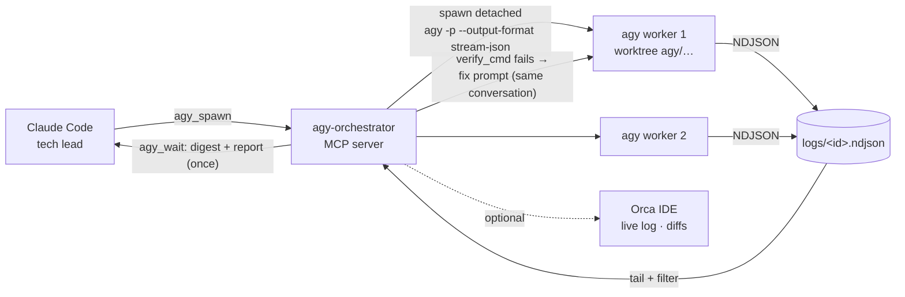
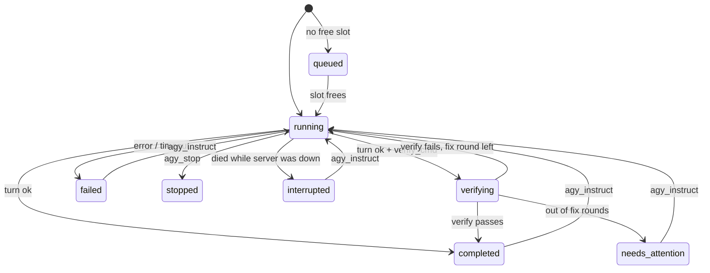

# agy-orchestrator-mcp

**Let Claude Code lead a team of Antigravity (`agy`) workers — with a fraction of the tokens.**

`agy-orchestrator` is a zero-dependency [MCP](https://modelcontextprotocol.io) server that turns
[Claude Code](https://claude.com/claude-code) into a tech lead for headless
Antigravity CLI (`agy`) sub-agents. Claude plans and decides; the workers read and edit code; the server does the
babysitting — running your tests, sending failures back to the worker, detecting stalls and loops,
isolating parallel work in git worktrees, and merging the result safely. It optionally integrates with
**Orca IDE** (by Stably AI) so you can watch workers live and review their diffs.

> 🇻🇳 Tiếng Việt: [README.vi.md](README.vi.md)

---

## Contents

- [Why](#why)
- [Features](#features)
- [How it works](#how-it-works)
- [Requirements](#requirements)
- [Installation](#installation)
- [Quick start](#quick-start)
- [Tools reference](#tools-reference)
- [Worker lifecycle](#worker-lifecycle)
- [Verify & auto-fix](#verify--auto-fix)
- [Attention flags](#attention-flags)
- [Safe merging](#safe-merging)
- [Persistence across restarts](#persistence-across-restarts)
- [Orca IDE integration](#orca-ide-integration)
- [Configuration](#configuration)
- [Notes on headless `agy`](#notes-on-headless-agy)
- [Token benchmarks](#token-benchmarks)
- [Testing](#testing)
- [Troubleshooting](#troubleshooting)
- [Limitations](#limitations)
- [Security](#security)
- [Project layout](#project-layout)
- [Contributing](#contributing)
- [License](#license)

---

## Why

Delegating to sub-agents only saves money if the orchestrator doesn't burn its own context watching them.
A naive orchestrator reads every streamed event, every full response and every diff — and does every
"run the tests, paste the failure back" loop itself.

This server moves that work out of Claude's context:

| Without the server doing it | With agy-orchestrator v2 |
| :-- | :-- |
| Claude polls status and reads raw event streams | `agy_wait` blocks server-side and returns a one-line digest per worker |
| Claude reads the full response to learn what happened | Workers return a structured report (`--json-schema`), delivered **once** |
| Claude runs tests, reads failures, re-prompts | `verify_cmd` runs server-side; failures go back to the worker automatically |
| Claude notices a stuck worker late (or never) | Stall / loop / permission-denied flags wake Claude early |
| Parallel workers clobber each other | Each worker can get its own git worktree + branch |
| Merging is manual and risky | `agy_merge` predicts conflicts first and never switches your branch |

Measured on the same 3-worker scenario: **`agy_wait` went from 7.3 KB to 0.4 KB (reports included)**, and
the tool schemas Claude loads shrank from ~6.3 KB to ~4.0 KB. See [Token benchmarks](#token-benchmarks).

## Features

- **8 compact tools** — spawn, wait, result, instruct, stop, list, merge, cleanup.
- **Fan-out in one call** — `tasks: [...]` with shared defaults.
- **Role presets** — `coder`, `tester`, `reviewer`, `researcher`.
- **Structured worker reports** — summary, files changed, commands run, tests, open questions, confidence.
- **Server-side verify loop** — run your test/lint/build command after each turn, auto-send failures back for up to N fix rounds.
- **Attention detection** — `stalled`, `looping`, `denied` flags; `agy_wait` returns early on them.
- **Concurrency limit with queueing** — default 4 running workers.
- **Git worktree isolation** — per-worker branch `agy/<id>`, diff vs base including untracked files.
- **Safe merge** — `git merge-tree` conflict prediction, secret-file refusal, never switches branches.
- **Survives MCP restarts** — workers run detached and log to disk; the server re-attaches on start.
- **Orca IDE integration (optional)** — show worktrees in the sidebar, live log terminal, open diffs for review.
- **Zero dependencies** — plain Node.js ≥ 20, nothing to `npm install`.

## How it works



1. `agy_spawn` starts each worker as a **detached** `agy -p --output-format stream-json` process whose stdout goes straight to `logs/<id>.ndjson`.
2. The server **tails** that file, keeps only milestones (tool calls, errors, results), coalesces repeats (`read_file ×7`) and drops text deltas.
3. When a turn ends, the server computes a change summary against the worker's base commit and, if `verify_cmd` is set, runs it. Failures are sent back to the worker in the same `agy` conversation.
4. `agy_wait` wakes Claude only when a worker is done or needs attention, and hands over each report exactly once.

## Requirements

| Requirement | Notes |
| :-- | :-- |
| Node.js ≥ 20 | No npm packages needed. |
| [Antigravity CLI](https://antigravity.google) (`agy`) | Logged in; `agy -p "hi"` should work. Found at `~/.local/bin/agy` or on `PATH`, or set `AGY_BIN`. |
| git ≥ 2.38 | Only for worktrees and `agy_merge` (`git merge-tree --write-tree`). |
| Claude Code | Or any MCP client that supports stdio servers. |
| Orca IDE *(optional)* | Desktop app running; CLI at `/Applications/Orca.app/Contents/Resources/bin/orca` or on `PATH`. |

## Installation

```bash
git clone https://github.com/dattnguyen16/agy-orchestrator-mcp.git ~/.claude/mcp-servers/agy-orchestrator
cd ~/.claude/mcp-servers/agy-orchestrator
npm test   # optional: runs the test suite against mock agy/orca binaries
```

Register the server with Claude Code (user scope, available in every project):

```bash
claude mcp add --scope user agy-orchestrator -- node ~/.claude/mcp-servers/agy-orchestrator/server.mjs
```

Or add it to `~/.claude.json` / a project `.mcp.json` by hand:

```json
{
  "mcpServers": {
    "agy-orchestrator": {
      "type": "stdio",
      "command": "node",
      "args": ["/Users/you/.claude/mcp-servers/agy-orchestrator/server.mjs"],
      "env": { "AGY_MAX_CONCURRENT": "4" }
    }
  }
}
```

Install the companion **skill** — a short playbook that teaches Claude the token-lean workflow:

```bash
mkdir -p ~/.claude/skills
ln -s ~/.claude/mcp-servers/agy-orchestrator/skills/agy-monitor ~/.claude/skills/agy-monitor
```

Restart Claude Code (or run `/mcp` and reconnect) and check that `agy-orchestrator` shows 8 tools.

## Quick start

Ask Claude something like:

> Use agy workers to fix the failing tests in `src/parser/` and add a test for empty input. Run them in parallel worktrees and verify with `npm test`.

A typical session from Claude's side:

```jsonc
// 1. fan out
agy_spawn {
  "cwd": "/path/to/repo", "use_worktree": true, "verify_cmd": "npm test",
  "tasks": [
    { "name": "parser-fix",  "role": "coder",  "prompt": "Fix the failing tests in src/parser/. Only touch src/parser/." },
    { "name": "empty-input", "role": "tester", "prompt": "Add a test for empty input to tests/parser.test.ts." }
  ]
}
// → {"spawned":[{"id":"agy-parser-fix-3fa1c2","status":"running","branch":"agy/agy-parser-fix-3fa1c2"}, …]}

// 2. wait (blocks server-side, returns early on attention)
agy_wait { "wait_for": "all" }
// → {"agents":[{"id":"agy-parser-fix-3fa1c2","status":"completed","turn":2,"secs":41,"fix":"1/2",
//      "report":{"summary":"Fixed off-by-one in tokenize()…","files_changed":["src/parser/tokenize.ts"],
//                "tests":"npm test passes","confidence":"high"},
//      "changes":"1 files +3-2: src/parser/tokenize.ts +3-2","verify":"pass"}, …]}

// 3. integrate
agy_merge   { "agent_id": "agy-parser-fix-3fa1c2" }
agy_cleanup { "agent_id": "agy-parser-fix-3fa1c2", "delete_branch": true }
```

Real run (actual `agy`, `gemini-3.8-flash-low`, a repo with two planted bugs): the worker fixed `add()`,
the server's `verify_cmd` caught the second bug in `mul()`, sent it back, the worker fixed it, verify passed,
and the squash-merge landed — Claude read ~1.5 KB in total.

## Tools reference

All tools return compact JSON (null/empty/false fields omitted) or plain text.

### `agy_spawn`

Start one worker (`prompt`) or several (`tasks[]`). Top-level fields are defaults for every task.

| Param | Type | Default | Description |
| :-- | :-- | :-- | :-- |
| `prompt` | string | — | Task brief (single worker). |
| `tasks` | `{prompt, name?, role?}[]` | — | Fan-out. Each item inherits the top-level fields. |
| `name` | string | role or `worker` | Label, used in ids, branch names and commit messages. |
| `role` | `coder` \| `tester` \| `reviewer` \| `researcher` | — | Preset, see below. |
| `cwd` | string | server cwd | Absolute working directory. |
| `use_worktree` | bool | false | Create `.agy-worktrees/<id>` on branch `agy/<id>`. Use for parallel edits. |
| `base_ref` | string | `HEAD` | Base commit for the worktree. |
| `verify_cmd` | string | — | Shell command run in the worker dir after each turn. |
| `max_fix_rounds` | number | 2 | Auto-fix rounds on verify failure. |
| `model` | string | agy default | e.g. `gemini-3.8-flash-low` (see `agy models`). |
| `mode` | `accept-edits` \| `auto` \| `plan` | `accept-edits` | agy execution mode. |
| `effort` | `low`…`max` | agy default | Reasoning effort. |
| `skip_permissions` | bool | false | `--dangerously-skip-permissions`: allow shell commands. Pair with `sandbox` or a worktree. |
| `sandbox` | bool | false | `--sandbox` terminal restrictions. |
| `timeout_seconds` | number | 0 (none) | Per-turn limit. |
| `watch` | bool | false | Open a live log terminal in Orca. |
| `json_schema` | string | built-in report | Custom result schema (JSON string or file path). |

Advanced (accepted, not advertised in the schema to save tokens): `add_dirs` (string[]), `report` (false disables
the built-in report schema), `stall_seconds` (default 180), `verify_timeout_seconds` (default 600),
`dangerously_skip_permissions` (alias of `skip_permissions`).

**Role presets**

| Role | Mode | Extra | Preamble gist |
| :-- | :-- | :-- | :-- |
| `coder` | accept-edits | — | Minimal changes, follow local style, don't commit. |
| `tester` | accept-edits | `skip_permissions` + `sandbox` | Write/update tests, run them, report exact commands and results. |
| `reviewer` | plan | — | Read-only; report defects with file:line, severity, fix. |
| `researcher` | plan | — | Read-only; answer with evidence. |

Every prompt also gets: *"You run unattended… If blocked, stop and list the blockers in open_questions."*

**Built-in report schema** (enforced by `agy --json-schema`):

```json
{
  "summary": "≤ 5 short lines: what was done and the outcome",
  "files_changed": ["relative/paths"],
  "commands_run": ["…"],
  "tests": "what was run and the result, or 'not run'",
  "open_questions": ["blockers or decisions the worker couldn't make"],
  "confidence": "high | medium | low"
}
```

### `agy_wait`

Block until workers finish **or need attention**.

| Param | Default | Description |
| :-- | :-- | :-- |
| `agent_ids` | all active + unreported | Workers to watch. |
| `wait_for` | `any` | `any` or `all`. |
| `timeout_seconds` | 120 | 0–300. `0` returns a snapshot immediately. |

Returns `{timed_out?, agents: [digest]}`. A digest is `{id, status, turn, secs, fix, last, flags, error}`; for a
finished worker the first digest after it finishes also carries `report`, `changes`, `verify` (and `stderr` on
failure). Later digests omit them — use `agy_result` if you need them again.

### `agy_result`

| Param | Default | Description |
| :-- | :-- | :-- |
| `agent_id` | — | Required. |
| `view` | `report` | `report` · `full` (final response text) · `diff` (vs base, incl. new files) · `events` (last 30 milestones). |
| `paths` | — | Limit `diff` to these paths. |
| `max_chars` | 8000 | Budget for `full` / `diff`. |
| `orca_open` | — | `"changed"` or a file path: open diffs in Orca for the user. |

### `agy_instruct`

Continue the same `agy` conversation (`--conversation <id>`).

| Param | Description |
| :-- | :-- |
| `agent_id`, `prompt` | Required. |
| `interrupt` | Stop a running/verifying turn first. Without it, instructing a busy worker is an error. |
| `mode`, `model`, `effort`, `timeout_seconds` | Per-turn overrides. |

Resets the fix-round counter, so `verify_cmd` applies again.

### `agy_stop`

Kills the worker's whole process group (SIGTERM, then SIGKILL after 3 s), stops a running verify, or removes
a queued worker from the queue.

### `agy_list`

One line per worker: `id status tN secs branch [flags] — last event or change summary`.
`status`: `all` (default) · `active` · `done`.

### `agy_merge`

Commit the worker's uncommitted changes in its worktree and merge branch `agy/<id>` into the branch currently
checked out at the repo root. See [Safe merging](#safe-merging).

| Param | Default | Description |
| :-- | :-- | :-- |
| `agent_id` | — | Required; worker must have `use_worktree: true` and be finished. |
| `strategy` | `squash` | `squash` or `merge` (`--no-ff`). |
| `message` | `agy(<name>): <report summary>` | Commit message. |
| `target_branch` | checked-out branch | Must equal the checked-out branch; otherwise refused. |

### `agy_cleanup`

Remove the worktree (default), optionally delete `agy/<id>` (`delete_branch: true` — allowed after a squash
merge), `force` for dirty worktrees/unmerged branches, and forget the worker. Logs are kept.

## Worker lifecycle



`queued`, `running` and `verifying` count as active; the others are terminal. A worker holds its concurrency
slot through `running → verifying → running (fix)`.

## Verify & auto-fix

With `verify_cmd`, after every successful turn the server runs `/bin/sh -c "<verify_cmd>"` in the worker's
directory (own process group, `verify_timeout_seconds` limit, full output in `logs/<id>.verify.log`).

- **Pass** → `completed`, `verify: "pass"`.
- **Fail** and rounds left → the worker gets, in the same conversation:
  *"The verification command `<cmd>` failed (exit N). Fix the root cause with minimal changes; do not weaken or skip the checks. Last output: …"* (last 80 lines).
- **Fail** and no rounds left → `needs_attention` with the last 30 lines in the digest.

Good `verify_cmd`s are fast and scoped: `npm test -- src/parser`, `pytest tests/test_parser.py -q`,
`tsc --noEmit`, `cargo check`. They run with **your** permissions, not sandboxed.

## Attention flags

| Flag | Trigger | Suggested reaction |
| :-- | :-- | :-- |
| `stalled` | No new event for `stall_seconds` (default 180). | `agy_result view:"events"`, then `agy_instruct interrupt` or `agy_stop`. |
| `looping` | Same tool with identical arguments ≥ 5 times in a row. | Redirect with a more specific instruction. |
| `denied` | agy auto-denied a shell command in headless mode (only flagged when there's no `verify_cmd`). | Add `verify_cmd`, or respawn with `skip_permissions` + `sandbox`/worktree. |

A worker that finished with `denied` and no `verify_cmd` ends in `needs_attention`, because agy still reports
`SUCCESS` even though it could not run what it wanted to.

## Safe merging

`agy_merge` is designed to never leave your repo in a broken state:

1. **Never switches branches.** Target = whatever is checked out at the repo root. A different `target_branch` is refused.
2. **Refuses a dirty target** (tracked changes at the repo root).
3. **Refuses likely secrets** in the worktree: `.env*`, `*.pem`, `*.key`, `id_*`, `*.p12`, `credentials.json` — remove or gitignore them first. Otherwise commits with `git add -A` (respects `.gitignore`).
4. **Predicts conflicts** with `git merge-tree --write-tree` (touches no working tree). On conflicts it returns the file list and changes nothing.
5. **Merges** with `--squash` + commit (default) or `--no-ff`; rolls back on failure.

If the repo has no git identity configured, commits fall back to `agy-orchestrator <agy-orchestrator@localhost>`.

## Persistence across restarts

- Workers are spawned **detached** with stdout/stderr redirected to files, so they keep running if Claude Code restarts the MCP server (`/mcp` reconnect, new session).
- The registry is saved (debounced) to `state/agents.json`.
- On start the server restores it:
  - worker still alive → keep tailing its log;
  - worker exited with a result → finished (if it had `verify_cmd`, it becomes `needs_attention`: verify is never re-run silently);
  - worker gone without a result → `interrupted` (resume with `agy_instruct`);
  - a verify that was running → `needs_attention`.
- Finished workers older than `AGY_RETENTION_DAYS` (and their logs) are pruned, unless they still own a worktree.
- By default workers are **not** killed when the server exits. Set `AGY_KILL_ON_EXIT=1` to kill them.

## Orca IDE integration

All Orca calls are best-effort: failures become `warnings`, never errors. The server never runs `orca open`
and never passes `--focus` (it won't steal your window).

| Feature | How |
| :-- | :-- |
| Worktrees in the sidebar | On worktree creation: `orca repo set --repo path:<root> --external-worktree-visibility show`. The repo must already be added to Orca (`orca repo add`); otherwise you'll see `repo_not_found`. |
| Live view | `watch: true` → `orca terminal create --worktree path:<dir> --title agy:<name> --command "node bin/agy-tail.mjs <log>"`, a colorized live log (tool calls, streamed text, verify results). |
| Review handoff | `agy_result { orca_open: "changed" }` → `orca file open-changed --mode diff`; a path → `orca file diff <path>`. |

You can also run the live viewer anywhere: `node bin/agy-tail.mjs logs/<id>.ndjson`.

Set `AGY_ORCA=0` to disable Orca entirely.

## Configuration

| Variable | Default | Description |
| :-- | :-- | :-- |
| `AGY_BIN` | `~/.local/bin/agy`, else `agy` | agy executable. |
| `AGY_LOG_DIR` | `<server>/logs` | Per-worker `*.ndjson`, `*.stderr`, `*.verify.log`. |
| `AGY_STATE_DIR` | `<server>/state` | `agents.json`. |
| `AGY_MAX_CONCURRENT` | `4` | Running + verifying workers; the rest are `queued`. |
| `AGY_RETENTION_DAYS` | `7` | Prune finished workers and logs after this. |
| `AGY_KILL_ON_EXIT` | unset | `1` = kill workers when the server exits. |
| `ORCA_BIN` / `ORCA_CLI_COMMAND` | Orca.app bundled CLI, else `orca` | Orca CLI. |
| `AGY_ORCA` | unset | `0` = disable Orca integration. |

## Notes on headless `agy`

Observed with the `agy` CLI as of November 2026 (fixtures in `test/fixtures/`):

- **Shell commands are auto-denied in `-p` mode** unless `--dangerously-skip-permissions` is passed (or an allow-rule exists in agy's `settings.json`). The turn still ends with `status: SUCCESS`; the denial only shows up in `result.denied_actions`. The server surfaces it as the `denied` flag.
- **A denied command aborts the turn.** agy stops right there ("no output produced") and never runs the `--json-schema` step, so the report is lost. The server therefore tells workers without `skip_permissions` not to run shell commands (and that it will run `verify_cmd` itself). If a report is still missing, the digest says so in `report.missing` instead of returning nothing.
- **`--json-schema`** puts the parsed object in `result.structured_output` and costs the worker one extra short step. Disable with `report: false`.
- **`--disable-slash-commands` turns `--mode plan` into a no-op** (agy prints a warning). The server passes it only outside plan mode.
- Stream format: `{"event":"init"}`, `{"event":"step_update","step_update":{step_type, state, tool_name, tool_info, text_delta, usage}}`, `{"event":"result","result":{status, response, structured_output, usage, denied_actions}}`.

## Token benchmarks

Same scenario on v1 (the original single-file server) and v2: 3 workers, each reading 4 files and returning a result.

| Payload Claude reads | v1 | v2 |
| :-- | --: | --: |
| `tools/list` (tool schemas) | ~6,340 B | ~3,990 B |
| `agy_wait` for all 3 | 7,306 B | 435 B *(reports included)* |
| `agy_result` for one worker | 1,164 B | 274 B *(usually unnecessary)* |

Reproduce with the size assertions in `test-mcp.mjs`.

## Testing

```bash
npm test
```

21 end-to-end tests drive the real server over stdio with mock `agy` and `orca` executables:
report parsing, event filtering, role flags, worktree diff with untracked files, merge refusal / conflict
prediction / squash merge, verify fail→fix→pass, verify exhaustion, verify timeout, denied/loop/stall flags,
concurrency queue, process-group kill (including grandchildren), interrupt + resume, restart with a live
worker and with a dead one, Orca calls and Orca failure fallback, and payload size budgets.

## Troubleshooting

| Symptom | Cause / fix |
| :-- | :-- |
| Worker `completed` but did nothing that needed a shell | Look for the `denied` flag. Use `verify_cmd`, or `skip_permissions` + `sandbox`. |
| `needs_attention`, "finished while server was down; verify_cmd was not run" | Run your check yourself or `agy_instruct` the worker to continue. |
| Orca warning `repo_not_found` | Add the repo in Orca (`orca repo add --path <repo>`), then spawn again. |
| `agy_merge`: "not the branch checked out" | Check out the target branch yourself; the tool never switches branches. |
| `agy_merge`: "possibly sensitive files" | Delete or gitignore the listed files in the worktree, then retry. |
| `agy_cleanup` refuses to delete the branch | It isn't merged; pass `force: true` if you're sure. |
| `agy_wait` returns `timed_out` repeatedly | The worker is still working; check `last` in the digest. The cap is 300 s per call. |
| Tools missing in Claude Code | `/mcp` → reconnect `agy-orchestrator`; check `node --version` ≥ 20. |

Raw logs: `logs/<id>.ndjson` (agy stream + server markers), `logs/<id>.stderr`, `logs/<id>.verify.log`.

## Limitations

- The stream-json schema is not formally documented by agy; the parser is built from observed output and keeps a generic fallback. A future agy release may need parser updates.
- Orca integration is verified against Orca 1.4.272 (worktree visibility, live terminal, open-changed) and depends on your repo being added to Orca.
- `verify_cmd` runs unsandboxed with your user's permissions.
- Process liveness after a restart is checked by PID, so PID reuse is theoretically possible on a long-idle machine.
- Tested on macOS. Linux should work; Windows is untested (process groups, `/bin/sh`).

## Security

- `verify_cmd` and `skip_permissions` execute arbitrary commands. Only use them in repos you trust, ideally in worktrees and with `sandbox`.
- Logs may contain code, prompts and command output from your projects. `logs/` and `state/` are gitignored; don't publish them.
- `agy_merge` refuses common secret files, but that is a safety net, not a guarantee. Review what you merge.

## Project layout

```
server.mjs            JSON-RPC 2.0 stdio transport
lib/engine.mjs        detached processes, log tailing, queue, verify/auto-fix, restore
lib/events.mjs        stream-json parser (schema: test/fixtures/*.ndjson)
lib/git.mjs           worktrees, change summary, budgeted diff, safe merge
lib/orca.mjs          Orca IDE integration (best-effort)
lib/state.mjs         persistence
lib/tools.mjs         tool schemas + handlers, role presets
lib/util.mjs          helpers
bin/agy-tail.mjs      live log viewer (used by Orca watch terminals)
skills/agy-monitor/   Claude Code skill: the orchestration playbook
test-mcp.mjs          end-to-end tests with mock agy/orca
test/fixtures/        real agy stream-json captures
```

## Contributing

Issues and PRs welcome. Please:

- keep the server dependency-free;
- keep tool descriptions short — every byte is loaded into the orchestrator's context;
- add or update a test in `test-mcp.mjs` and run `npm test`;
- if agy's stream format changes, add a new fixture in `test/fixtures/` captured with
  `agy -p "<task>" --output-format stream-json > test/fixtures/<name>.ndjson` (scrub local paths).

## License

[MIT](LICENSE)
